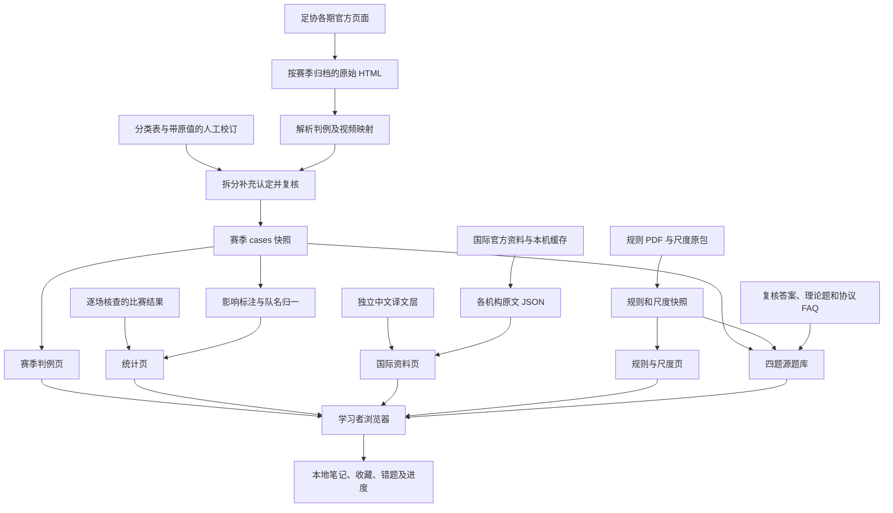
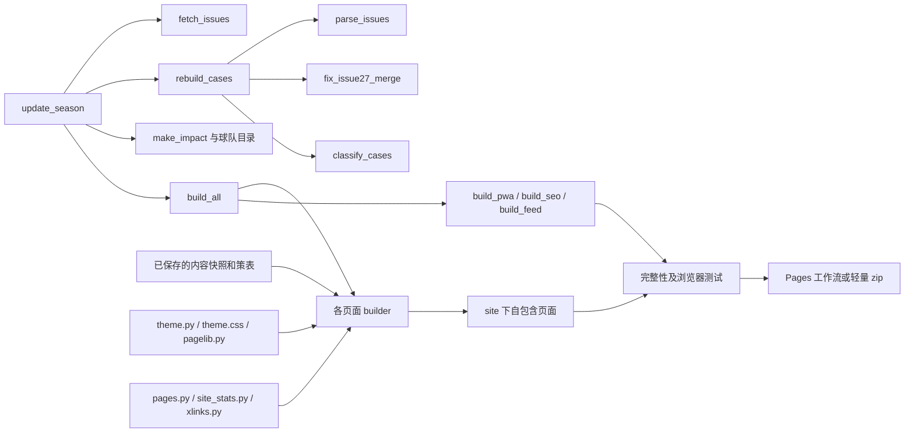

# 裁判学习平台架构

学习者直接打开发布目录中的 HTML 即可阅读判例、查规则和答题。维护者通过 Python 将官方归档、结构化数据与人工复核结果编译进页面。联网工作主要发生在获取新资料时；已保存的三季数据足够完成日常站点构建。目录约束和历史原因另见[路径契约](structure.md)。

## 从官方材料到学习记录

### 内容及其权威来源

| 内容 | 权威记录和身份 | 主要消费方 |
|---|---|---|
| 国内判例 | `data/issues/赛季/` 保存发布原文。`cases-赛季.json` 包含期号、期内编号、赛季序号和官方 URL。2025 第 27 期对第 26 期的补充认定按原案例归属。`case-overrides.json` 保存有原值校验的人工修正 | 赛季页、统一搜索、题库、统计、门户、订阅 |
| 得失盘点 | `make_impact*.py` 的逐例标注、`impact-赛季.json` 与人工维护的 `match-scores-赛季.json`。一个判例可有多个影响事项，同场可能有多个判例 | 三季统计页，按受损或获益球队查看 |
| 规则与尺度 | `laws.json`、`scale.json` 提供 CI 可读快照。`rule-editions.json` 和 `law-annotations.json` 保存版本与校注。`xlinks.json` 连接国内分类、规则章节与尺度场景 | 规则、尺度、搜索、赛季详情、题库 |
| 国际资料 | 机构原文和 URL 与 `*-zh.json` 译文分开维护。各库的键包括 UEFA 判例 ID、RFEF 判例编码、CONMEBOL 文章 URL、weekly 期目 ID、HNS 轮次和条目号。IFAB 还核对子块与条目顺序 | 国际资料页、搜索、协议题 |
| 题库、学习路径 | 判例题保留 `赛季-seq` 作为键。`quiz-answers.json` 对 `reviewed` 条目提供判罚或纪律轴。尺度题、协议题、理论题有各自的入池条件，学习路径由人工策表维护 | 训练、限时模考、复习、Anki 导出 |
| 队徽与媒体 | `crest_overrides.json` 保存已核验归属，`teams.json` 和 `crests.json` 由脚本生成。原始图片位于 `assets/`，本机视频位于 `site/videos/`。候选与出处位于 `data/local/crest-candidates/` | 显示队徽、视频学习、轻量版官方链接 |

## 模块如何协作

- `update_season.py` 按赛季调用抓取、重建、影响标注、球队目录、队徽校验、站点构建及完整性检查。`rebuild_cases.py` 在内存中按顺序解析、拆分、分类、套用人工修正，成功后写入正式 JSON。抓取和解析 URL 表仍需同步。[赛季接入指南](add-new-season.md)
- `build_all.py` 通过当前 Python 解释器执行各 builder，子进程失败即终止。规则和尺度均走 `--from-json`，搜索从数据生成内联索引，发现层生成 Atom、sitemap、manifest 和 Service Worker。根 `assets/` 在构建时复制为发布资源。[构建入口](../scripts/build_all.py)
- 原始素材更新按需单独执行。尺度显式 `--extract` 验证既有场景身份和源媒体。多个国际库在本机缓存中获取或解析页面，完整快照通过核对后原子写入，纯缓存重解析沿用线上核查日期。译文独立提交；新条目需要补译并运行对齐检查。[译文贡献指南](translation-guide.md)
- `src/theme.css` 和 `lib/theme.py` 提供主题、图标、顶栏与通用脚本，列表型国际页面还使用 `lib/pagelib.py`。各 builder 在构建期内联样式、模板、数据和核心交互脚本。门户从 `src/portal.html`、`src/portal.css` 与同目录的脚本生成，把判例示例和两张图片嵌入首页。图片动效在 HTTP 下加载随包的原版模块；双击文件或模块离线时可使用首页中的同版实现。`src/learning-records.js` 供赛季与规则页复用，`src/study-calendar.js` 负责本地自然日计数。

## 浏览器、离线与发布边界

| 行为 | 存储或接口 | 维护要点 |
|---|---|---|
| 赛季收藏、笔记、已读和上次打开 | 每季独立的 `cfa2026.fav/notes/seen/last` 等键。收藏及笔记的逐条变化写入版本键，并兼容旧聚合键 | 页面之间用 `#case-N` 和分类锚点跳转。跨标签页同一笔记的冲突文本保留供恢复 |
| 规则高亮、章节笔记和进度 | `cfa2026rules.hl/notes/read` 等键；章节与条款锚点同时被搜索、判例详情引用 | 稳定锚点承担跨页引用。新规则版本需要核对章节变动及个人标注的归属 |
| 答题和复习 | 每次作答以独立操作写入本地存储，兼容旧错题、统计和历史记录。进行中的模考用本标签页的 `sessionStorage` 保存题序、选项和绝对截止时间 | 重载读回原卷，交卷按尝试身份去重。旧尺度题编号发生碰撞时保留能证实的组累计数。[作答记录](../src/quiz-records.js) · [模考草稿](../src/quiz-session.js) |
| 教练课单与讲义 | `compare.html#coach` 复用判例目录。课单以赛季和序号引用案例，以独立版本键保存在浏览器。导入教练 JSON 会生成新课单 | `coach-model.js` 只投影学员可见字段，`coach-handout.js` 负责在线及独立文档呈现。分享链接的片段携带编排和题目，独立 HTML 还保存导出时的正文。跨期补充认定来自同一判例目录。[课单模型](../src/coach-model.js) · [讲义输出](../src/coach-handout.js) |
| 双击 HTML 与 HTTP(S) | 完整版优先本地媒体，轻量版使用文本和官方链接。HTTP(S) 的 Service Worker 按安装路径和构建版本隔离缓存 | 双击方式直接读取页面。缓存配额不足时仍可阅读已收到的在线响应，跨访问方式迁移个人资料可导出再导入。[离线构建](../scripts/build_pwa.py) |
| CI 与交付 | `ci.yml` 执行构建、Python 与浏览器回归。手动运行时，Windows 作业把通过测试的离线 ZIP 保存为 30 天可下载的审阅附件 | `site/` 是发布根。打包器从登记的页面、队徽、图解与站点资源生成 ZIP。Pages 工作流及正式 Release 各有独立入口。[CI](../.github/workflows/ci.yml) · [打包清单](../scripts/package_site.py) |

维护者可以用 `python scripts/validate_schemas.py` 检查数据契约，用 `python scripts/translation_status.py` 查询译文覆盖，用 `python -m pytest tests/ -q` 检查解析、重建、发布保护和完整性。浏览器脚本消费构建后的真实页面，对交互、存储和离线缓存进行独立验证。
