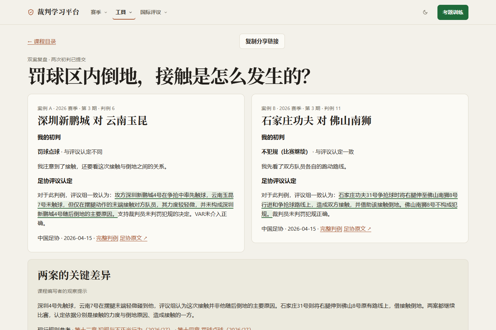

# 2026 年 11 月裁判学习平台开发与验收记录

## 工作起点

原分支 `codex/learning-reliability` 位于 `5f6d3e8`，有 64 份跟踪文件改动、16 个新文件。在相邻的独立工作树中复制并逐份校验这 80 份内容，保存为 `65fea8e`。本轮代码在 `codex/astra-62-audit-modernization` 上开发，基线仍可单独检出。媒体、外站缓存及个人浏览器存储留在各自原处。

## 从复现到修复

| 工作范围 | 对使用者或维护者的改变 | 可复验的入口 |
|---|---|---|
| 来源数据与人工审核 | 普通构建使用已提交尺度快照。正式发布来源前核对记录身份及覆盖，失败保留旧数据和核查日期。重新起草答案保留 605 项人工复核。队徽候选进入待核队列。 | `python -m pytest tests/test_source_protection.py -q` |
| 统计与规则 | 核对 6 场比赛日期，纠正江西庐山对黑龙江冰城为 0∶0，辽宁铁人对大连英博为 2∶1。足协 2024 #90 只认定漏判越位，停止错误扣球；同一判例多项影响分别统计。恢复 113 条补时分钟，修复两期补充认定的视频归属。 | [比分与逐场来源](../data/match-scores-2024.json) · [数据回归](../tests/test_audit_data.py) |
| 个人学习 | 旧笔记与收藏可继续使用。并行编辑保留同条笔记的分支；保存失败显示草稿状态，能导出或重试。按本地日期打卡。薄弱点可进入专项练习，模考采用绝对截止时间和原始分数判定。 | [学习浏览器回归](../tests/browser_learning_audit.js) |
| 首屏与移动学习 | 首页能搜索、开始当日判例或续学，课程入口按用途分组。修复手机主题图标、导航焦点、RFEF 查询区溢出、深色判定对比度。 | [设计和截图](UI_UX_REDESIGN.md) |
| 发布和离线使用 | 404 链接解析部署的实际根目录。缓存摘要包含构建好的 404。另实测出已缓存搜索页在断网搜索新词时仍落到 404；修复后按静态 HTML 路径查找，原页面读取新查询并列出结果。媒体校验区分缺失、损坏和远端不可核验，断点续传拒绝将超长文件当成成品。 | [离线回归](../tests/browser_offline.js) · [校验器](../scripts/verify_videos.py) |

实播中另外发现一项官方视频回退问题。2026 #229 已用原有的 71,074,952 字节视频测试本地播放和 Range 跳转，从长 82.013 秒的片段跳至 57.409 秒。#230 在本地缺片时，Chrome 曾把本地来源地址发送给官方 CDN，无法解码。赛季与考试页面改用文档级来源策略后，实测同一官方地址收到 206，解码 1920×1080、40.751 秒并推进播放。CI 使用拦截请求的回归验证请求头，线上地址的可用性按实际站点为准。

## 验收入口与覆盖

1. 运行 `python scripts/build_all.py`、`python scripts/validate_schemas.py`、`python scripts/translation_status.py` 和 `python -m pytest tests -q`。本机 Python 3.12.13 的 75 项回归通过，较基线新增 36 项。4 份契约覆盖 8 个文件，6 层译文身份与结构检查通过。内容语义仍需专业复核。
2. 运行 `python -m ruff check scripts tests`、`python -m ruff format --check scripts tests` 和 `git diff --check`。还用有意失败的独立断言确认 CI 固定的 Playwright CLI 0.1.24 会返回非零退出码。
3. 在隔离 Chrome 中执行仓库的 smoke、learning_audit、interface、offline 四套脚本。另从中文路径打开实际 ZIP，断网访问全部页面，执行搜索、规则定位和答题。测试在临时浏览器上下文中写入学习资料。
4. 从两份只有源码、资产和已提交数据的目录各自构建。逐项比较全部生成文件，并检查轻量 ZIP 与发布目录的逐项内容。发现以集合迭代输出的联赛键次序不稳定，已按联赛排序。

版本规模为 85 期、627 例、629 个国内视频路径、104 个尺度场景、842 道题和 3,421 份检索文档。轻量站含 22 个 HTML，包含 404。项目原工作区中的国内媒体路径做过存在检查；完整 CDN、全球视频内容及每条译文的专业语义均超出本轮已测范围。[逐项审计](BUG_TRACKER.md)

## 性能口径

使用同台 Windows 的桌面 Chrome 157，以 `file://` 打开本地轻量页面。修复前后交替加载，各取七次的中位数，390px 和 1440px 分别测量。载入数字为导航的 DOMContentLoaded，搜索数字为设置“手球”、执行结果渲染至强制读取结果区排版的耗时。该采样不包含网络下载，也不代表手机处理器速度。

### 第一版门户对照样本

| 页面或动作 | 390px 旧版 → 第一版门户（ms） | 1440px 旧版 → 第一版门户（ms） |
|---|---:|---:|
| 首页 | 21.1 → 22.4 | 44.1 → 30.8 |
| 考试 | 36.5 → 32.2 | 37.4 → 34.4 |
| 全站搜索载入 | 30.6 → 32.5 | 34.7 → 31.7 |
| 搜索「手球」和结果排版 | 6.9 → 8.4 | 6.7 → 6.5 |
| 2026 赛季判例 | 66.1 → 73.2 | 88.2 → 90.7 |

第一版门户的两轮净构建耗时 6.80 和 7.98 秒，169 个文件逐字节相同。Windows 的 Python 3.9.13、3.11.9、3.12.13 各自运行 75 项测试均通过，三个版本的构建产物相同。轻量 ZIP 的 111 个成员逐个与构建目录相符，中文路径断网打开 22 页，1,408 个当时参与布局的图片元素解码成功。以上数字记录第一次整体验收时的候选。

### 发布条件的调整

第一版门户的真实交互、响应式和离线测试已通过；Taste 三轮原始汇总分别有 39、22、20 项未通过。摄影、分屏、页面结构与动效仍需要设计工作。2026 年 11 月 20 日，维护者明确要求以 Taste 原始检查全部通过为上传前提，继续开发新版主页并重新验收。

## 最终候选验收（2026-11-20）

- **构建与内容。** 将 405 份源输入分别置于两个干净目录，完整构建耗时 8.80 秒和 7.58 秒。176 个产物均与工作树内对应文件逐字节相同。Windows Python 3.9.13、3.11.9、3.12.13 各通过 75 项测试。Ruff 代码检查通过，80 个 Python 文件格式检查通过。相对保存的原工作快照，本轮提交通过 Git 空白检查。相对旧 main 检查完整差异时，Git 另外标出了快照中三份足协原始 HTML 的行尾空格和既有规划文档的两个 Markdown 硬换行，保留来源文本。
- **视觉。** Windows 发布候选首页 SHA-256 为 `eb78d74ccdbf668c7a07f80a5a3bbda448c9e643b75e3c017f50654132cf9993`。在其完整站点副本上，原始 Taste 完成检查为 GATE: PASS（0 FAIL、3 WARN），全宽一致性为 0 FAIL、7 WARN，文案与性能各为 0 FAIL、0 WARN。全部项目均已执行，未使用豁免。五档布局含长标题压力测试均为零项发现。原始性能工具在 390px 和桌面各测三次，手机 FCP/LCP 中位数为 136ms，桌面为 152ms，两者 CLS 为 0。[布局、截图与提示](UI_UX_REDESIGN.md)
- **离线发行包。** 118 个 ZIP 成员逐项与构建目录对照。解压到中文路径后，Chrome 157 完全断网访问 22 个页面，1,410 个参与布局的图片实例成功解码，页面异常为零。已实际完成搜索、规则跳转和答题。手机和桌面分别在 HTTP 与断网重载时验证正确图片尺寸。经过验收的 Windows 轻量包为 8,845,475 字节，SHA-256 为 `6e0d41734f23148798bea30ca07002f899bd9dc795611016118d01d89fb967dc`。该摘要对应这次本地 ZIP，其他平台重新打包后应核对其自身发布摘要。

- **浏览器流程。** 使用 CI 固定的 Playwright CLI 0.1.24 逐套执行 smoke、learning_audit、interface、offline，四套均返回 PASS。再测全部 22 页的五档宽度，共 110 组，无页面级横向溢出或脚本异常。三个宽度交叉浅色／深色、完整版／轻量版，264 次打开均通过。

### 最终版与原工作树的同机对照

| 页面或动作 | 390px 旧 → 新（ms） | 1440px 旧 → 新（ms） |
|---|---:|---:|
| 门户 DOMContentLoaded | 20.1 → 32.5 | 68.2 → 35.1 |
| 考试 DOMContentLoaded | 34.6 → 30.0 | 36.4 → 30.7 |
| 全站搜索 DOMContentLoaded | 30.2 → 31.9 | 30.5 → 32.0 |
| 搜索“手球”并排版 | 6.7 → 6.5 | 6.5 → 6.2 |
| 2026 赛季 DOMContentLoaded | 63.9 → 65.8 | 85.7 → 82.7 |

使用同一浏览器 Chrome 157.0.8103.79，对原工作树与发布候选交替测量七次，取中位数。桌面首页和两档考题页在这组采样中更快。390px 首页多用 12.4ms，搜索页载入多用约 2ms。双击离线 HTML 时内联了首页的实际案例和响应式照片。手机选用 42,354 字节的小图；标准桌面使用 197,658 字节的大图。这里的速度是同一台电脑模拟两种视口的本地样本。

## 2026.11.3 候选 · 裁判尺度对照课

打开[尺度对照课](../site/compare.html)，可先练四课八案，再从三个赛季 627 个判例的十个教学分类里选两个同类判例自由对读。四堂精编课选用 2026 年足协评议。手球比较 #1 与 #28，越位比较 #14 与 #29，纪律处分比较 #94 与 #47，罚球区接触比较 #13 与 #18。最后一组两案都支持继续比赛，评议给出的理由不同。[选案、引句和观察区间](../data/compare-lessons.json)

- **内容与影像。** 逐案比对所问答题轴、足协归档、视频身份和引句。八个观察区间共解码 2,922 帧，音轨采样峰值均为零。用 Chrome 实播八条 1080p 原片检查首末可见帧，修复了旧播放器可能提早约一帧显示画面的问题。无视频时可用文字材料并记录“现有画面不足以判断”。[数据核验](../tests/test_compare.py)
- **自由对读与出处。** 两案可以跨赛季，分享链接只带课程或判例身份。本机 HTTP 或双击 HTML 分享时使用站点公开地址，其他部署保留当前地址。四例没有单列认定的记录直接说明情况。2025 年 #183、#188 分别保留第 26 期原文和第 27 期补充认定链接。
- **个人记录。** 盲判、草稿与复盘分别按尝试保存。两页续写同一草稿时各自的版本可从历史中打开。存储失败时页面保留当前文本，可重试或打印。移动端复盘的打印输出包含 A、B 两案及反思；自由对照单只打印所选案例。[浏览器回归](../tests/browser_compare.js)
- **离线与维护。** 构建时将自由判例目录以 16 位 LZW 编入单个 HTML，打开工作区时还原。浏览无需库、网络服务或外部数据文件。构建回归将解码后的每条记录与数据源逐项比较。[生成器](../scripts/build_compare.py) · [完整目录回归](../tests/test_compare_archive.py)

### 候选包实测

三个独立目录分别使用 Windows Python 3.9.13、3.11.9、3.12.13 构建，耗时依次为 11.88、10.74、9.65 秒，各自通过 97 项测试。183 个生成文件逐项与最终工作树一致，84 个 Python 文件通过 Ruff 检查和格式检查。仓库 CI 固定的 Playwright CLI 0.1.24 已在 Chrome 中依次通过 smoke、learning_audit、interface、offline 和 compare 五套脚本。

中文路径解压后的轻量包包含 125 个文件，共 9,432,169 字节，Windows 实测包的 SHA-256 为 `1990ed5f457b932ed72ed0a95b814c6d27d3df1d85bf6beb08b098c3852b1850`。完全断网访问全部 23 个 HTML，1,413 个可见图片实例全部解码，页面异常为零。精编复盘单实测生成 2 页 PDF，含双方初判、原文与反思；自由对照单为 1 页 PDF，含双方判例。轻量包沿用原有分发方式，大视频另行下载。

课程 HTML 共 616,682 字节。下表使用桌面 Chrome 157，在本机 HTTP 服务关闭缓存与 Service Worker，各视口测五次取中位数。两个工作区都从新打开的文档进入，耗时从点击到目标控件完成渲染后两帧。390px 为模拟视口。

| 视口 | 页面 load | 首次打开自由配对 | 首次打开手球盲判 |
|---|---:|---:|---:|
| 390 × 844 | 119.3 ms（27.4–169.7） | 66.4 ms | 28.7 ms |
| 1440 × 900 | 27.4 ms（25.8–30.4） | 59.7 ms | 30.0 ms |

在同一冻结版本的 HTTP/1.1 副本上，Taste 2.5.1 的首页和课程入口均返回 **GATE: PASS**。原始门槛分别有 3、2 条非阻断警告。1440、1024、820、768、390px 的完整一致性检查分别为 0 FAIL / 7 WARN、0 FAIL / 8 WARN；课程入口的提示涉及中文标题、留白及链接样式。两页的五档布局压力测试均无发现，文案和性能检查各为 0 FAIL、0 WARN，全程未使用豁免或修改检查程序。课程入口的浅色、深色主按钮对比度实测为 6.52∶1 和 9.80∶1。

## 2026.11.4 候选 · 教练备课与学员讲义

从已验收的尺度对照课提交 `cfeba7f` 建立独立分支。本轮沿用三季 627 个判例的稳定编号、四堂精编课的观察提示和官方出处。双案复盘和自由配对可以直接生成课单，教练也可以按分类、赛季、球队或期次从头选案。[教练备课](../site/compare.html#coach)

1. **备课。** 给课单起名，加入判例并调整顺序。课堂问题与学员可见的情境可以带到投屏和讲义。私人追问放入教练备注，换电脑时用教练 JSON 备份导入副本。
2. **上课。** 投屏只显示当前一案。左右方向键切换，R 揭晓或收起足协认定。精编案使用已核验的静音观察区间，其余有视频的案例由教练主动打开完整素材。返回上一案会重新进入讨论状态。
3. **发讲义。** 讨论版可在课前发给学员。勾选认定和出处后可生成复盘版，保留跨期补充认定和现行规则版本。分享链接保留选案顺序和教练编写的公开文字，浏览器打开时从该版本判例目录读取资料。要固定当天的原文或断网授课，使用独立 HTML 或打印为 PDF。

模型以独立修订键保存并行写入，单个标签页可在存储失败后重试或导出。学员视图、讲义 HTML 和打印内容从同一组公开字段生成。生成讲义与读取分享均无需账户、上传或服务端存储。[模型回归](../tests/test_coach_model.cjs) · [课堂流程回归](../tests/browser_coach.js)

### 备课工具候选包验收

- Windows Python 3.9.13、3.11.9、3.12.13 的三个干净目录各通过 98 项测试。完整构建分别用时 13.96、9.03 和 9.67 秒，183 个生成文件逐一与最终工作树比对相同。Node 的 8 项模型回归和 CI 固定的 Playwright CLI 0.1.24 六套 Chrome 回归均通过。
- 从中文路径解压，23 个 HTML 均可断网打开，1,413 个可见图像实例解码成功。包含 627 个不同判例的课单完成恢复、投至末案、导出全部讲义。七份备课与学员 PDF 经抽取文字核对，均未包含私人备注；其中两份从打开的原生弹窗直接打印，编排弹窗当时聚焦在私人备注上。
- 使用实际 1080p 本地素材按投屏顺序播放八个精编案例。抽到的 1,767 个可见帧采样均在指定区间内。另测原生全屏、全屏被拒继续上课、切换完整素材角度和停止上一案播放器。现场投影硬件尚待课堂试用。
- Windows 轻量包共 125 个成员，9,449,481 字节，SHA-256 为 `fcb9bd7005b2c1632e8b2bb5808b6161a6d3ac455a91c0c16f61bdb895450f0f`。其中课程 HTML 从上一候选的 616,682 字节增至 677,053 字节，增加 9.8%。Chrome 157 五次全新配置中，390px 和 1440px 视口的备课冷启动中位数为 211ms 和 209ms。该包已在解压目录实测，独立 HTML 讲义可单独转发。

- Ubuntu（WSL2，Python 3.12.3）另从待提交的 Git 文本快照重建并通过全部 98 项测试。Linux 重建与 Windows 归档的差异来自内联 JavaScript 的换行编码及按内容计算的 Service Worker 版本；解码并归一换行后，全部已跟踪站点文件核对一致。
- Taste 2.5.1 原始检查覆盖首页、尺度对照课及 `#coach`，三个入口均为 **GATE: PASS**，分别保留 3、2、4 条非阻断提示。全宽一致性各为 0 FAIL，提示数为 7、8、7。三入口的五档布局和长标题压力检查均无发现，文案及三轮性能检查均为 0 FAIL、0 WARN。桌面／390px 的 LCP 中位数依次为 132／136ms、112／116ms、212／196ms，CLS 均为零。另用 320、390、768px 触摸视口实际完成筛选、编排、投屏和讲义预览。

## 2026-11-20 三小时自主开发

| 项目 | 记录 |
|---|---|
| 开始时间 | 2026-11-20T14:02:11+08:00 |
| 截止时间 | 2026-11-20T17:02:11+08:00 |
| 起点 | `codex/3h-improvements-20261120-1402`，`797230ee30871c11b3c8478776742b8b934ba04c` |
| 本地资料 | 原工作树 64 份修改及 16 份新文件在内的 409 份 Git 输入均与祖先快照 `65fea8e` 匹配。视频、缓存留在原位置。 |
| 初始验证 | 同一提交的两次构建产物一致，98 项 Python、8 项教案模型和 6 套浏览器回归通过。Taste 2.5.1 对首页、对照课、教练备课三个入口的原始门禁通过。 |

优先处理双标签答题丢失记录、无效备份、损坏课单、国际判罚与索引，以及离线缓存。随后修复键盘路径，推出从三季详情复制官方判例引用的功能，复测性能、离线访问和视觉效果。独立开发分支的普通推送用于保存已验收批次，发布由维护者决定。

### 14:17 进度

已推送并逐次核对远端提交。RFEF 的 CAEF.3、PD.6 两个原文明确的复合判罚补全黄牌（`9307ca0`）。PWA 在 1 KiB 实际存储配额下仍能返回在线速查卡和静态资源，三个查询共用一份搜索页，旧缓存可迁移（`92f888b`）。损坏课单原件可以单独导出，两份健康课单在刷新和编辑后可用（`7da49fc`）。错题记录改为按作答独立保存，旧数据可读，新旧备份按整份校验，门户到期数与答题页一致（`c74dcd0`）。每批隔离构建及 Python 回归通过，新增 quiz 模型 5 项、教案模型 9 项均通过；Chrome 离线、教案、并发答题及学习回归分别通过。

继续处理键盘交互、国际索引、引用卡与题目身份。新核实的 2025 年尺度题共 18 道使用了 8 个重复键，某些错题会跳到不同系列。另已重现两处统计展示问题。

### 14:32 进度

赛季弹窗、两个国际页的跳转正文（`e63eecd`）、四个题源的键盘选择与批改锁定（`f3f8333`）、45 篇 PRO 西语索引归类（`a6e1c60`）和 RAP 期号合并（`28787b1`）均已推送。RAP 的离线索引回归覆盖已有 23 期与未确认来源处理，当前手工数据与生成页未发生变化。开发分支没有触发 GitHub Actions。

三季详情的判例引用已通过本机预览和双击 HTML 验证。2025 第 26 期 #183、#188 的原期和补充期可追溯，盲判链接保留隐藏答案，剪贴板不可用时可全选复制。390px 浅色和 1440px 深色实际页面均容纳 44px 操作目标。最新隔离构建及 108 项 Python 回归通过。继续验收学习记录恢复、尺度题键与统计口径。

### 14:49 进度

三季判例可从详情复制引用（`da8b3ce`）。笔记单项损坏时保留原件、快速离开前提交草稿（`05a57c5`）；异机导入相同笔记的两版文本均可恢复（`5d78d3f`）。错题双份快照与故障回放经 10 项 Node 测试和 Chrome 验证（`d9d636e`）。若两份快照已损坏且相关操作已清理，只能恢复可证明的计数下界，页面可导出受损原始资料。

门户移除首次多余布局（`208e58c`）。Chrome 157 每种条件交替取 7 次中位数，390px 离线 DCL 133.3→24.7ms，长任务 111→95ms，FCP/LCP 148→144ms，实际首次点击反馈变化小于 5ms。1440px 的 LCP 在 file/HTTP 增加 4/8ms，CLS 均为 0，改前后相同视口截图一致。

已修复 18 个尺度场景共用 8 个旧键，842 道题编号唯一，96 道尺度题来源逐一核实（`bfdd9ae`）。旧累计次数按组保留；是否能从最近错答识别一题与累计数归属分别处理。111 项 Python、11 项答题模型、9 项教案模型及 Chrome 新旧错题回归通过。远端已包含上述提交。继续处理比分视角、规则标注、手机顶栏、离线检索与分支安全审查。

### 15:16 进度

已推送比分与杯赛阶段修正（`42214b1`）、收藏标签按纯文本展示（`4856a8d`）、竞赛规则精确高亮并兼容旧标注（`34aa3d7`）。批量导入改为按条保留可恢复修订、整批只写一次兼容快照（`bdb267e`）。同机新配置各三轮，200 条笔记中位 141.1→30.8ms，500 条高亮 1313.6→17.1ms，实际刷新、并发写入和导入中断后重试通过。

固定范围 `797230e..bfdd9ae` 的安全审查完成。RAP 增量索引可能把不同端口或组织路径误认作官方学习入口，已在 `844990e` 限定 HTTPS 来源和组织路径，现有两条官方入口保留。当前隔离候选构建、125 项 Python 测试和 Ruff 检查通过。开发分支远端已核至 `844990e`。正在验收手机导航、离线搜索定位、模拟考试恢复和视频预览。

### 15:35 进度

已验收手机判例/规则导航及键盘焦点（`f553c5f`）。320、390、768、1440px 下逐项点击和键盘遍历通过，关闭抽屉后焦点返回入口。两段真实本地视频可播放、拖动；无视频的同页能用键盘转入文字学习。流式预览、断点及回退修复在 `6994f13`，31.97MiB 样本的 Python 分配峰值由约 34.3MiB 降至约 0.5MiB。

288 个 PRO/CONMEBOL 搜索结果直达本地卡片（`761ec29`）。IFAB 从 16 个粗粒度结果扩展为 274 个条款或问答，原有章节与 FAQ 书签可用。64 项原文版本绑定来自已有译制历史，官方原文变化后默认展示当前英文（`996be55`）。九张速查卡可键盘展开并从搜索直达，正面版一页 A4、完整细则三页（`e286327`）。

复现并修复旧页面编辑笔记后，新页写另一判例丢失旧页改动（`2d4a3b5`）；双页陈旧收藏按钮误删新标签（`eafe518`）。基于已发布旧页及两套当前页验证导出、重复导入、键盘和明确取消行为。RFEF 官方媒体来源、播放器回退与本地视频及分片路径在 `8cb088d` 校验，169 个现有视频链接保留。此时 Windows 最新候选 146 项 Python 测试通过，1 项真实符号链接测试受本机创建权限限制，正用 Ubuntu 验证。已核对远端；开发分支未触发 Actions。继续验收模考、错题备份、相邻站点离线更新和赛季筛选。
