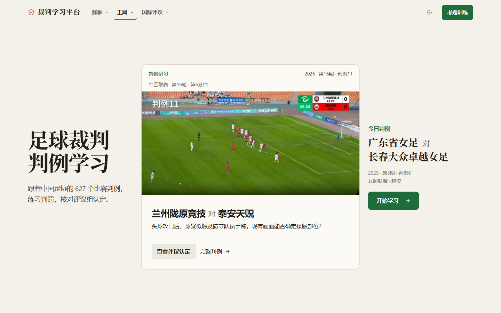

# 从首页进入一次裁判学习

首页面向两个时刻。第一次打开时，学员可以先看一张实际判例的比赛截图，试着自己判断，再揭晓评议组认定或直接打开今日判例。再次回来时，首屏可以继续上次学习的比赛；当日推荐与上次不同，另有今日判例入口。继续学习支持全部 627 个判例，选作每日练习的 622 个案例同时具备视频和评议认定。

## 判例、练习与资料

| 位置 | 学员操作和界面反馈 | 实现 |
|---|---|---|
| 门户 | 首屏呈现一条可操作的研习示例与今日或上次学习的对阵，手机按阅读顺序排列。第二屏可直接搜索，也可切换五组资料目录。末屏提供学习足迹、到期复习及完整／轻量模式 | [门户生成器](../scripts/build_portal.py) |
| 判例与规则 | 笔记旁直接显示保存情况。其他窗口编辑同一笔记时可查看、恢复或明确移除副本。空间不足时可重试和导出当前草稿 | [共享记录层](../src/learning-records.js) |
| 考试 | 学员可从薄弱分类进入专项训练；到期题有独立入口。交卷根据原始分数判定是否达到 90%，显示临界分差，切回后台时按截止时刻结算 | [考试生成器](../scripts/build_quiz.py) |
| 国际资料 | 西班牙手册在窄屏将查询和操作控件分行，长原文可自然换行。导航、焦点和主题样式由各页共用 | [RFEF 生成器](../scripts/build_rfef.py) |
| 键盘与手机 | 首个跳转链接可直接到正文。导航使用原生模态对话框，打开后聚焦关闭键，按 Esc 回到触发键。筛选、站点菜单和明暗开关各有独立图标与可读名称 | [顶栏模板](../scripts/lib/theme.py) · [交互回归](../tests/browser_interface.js) |

## 视觉取舍

沿用米色纸面、暖炭色暗面和陶土色导航细节。首页用球场绿标出主要动作。编辑标题用系统衬线字，表单、数据与操作文字使用系统 UI 字体；离线设备使用本机可用字形。主标题按宽度缩放，操作区复用 6、10、13px 圆角。门户分为首屏、资料目录、学习记录三个完整屏幕；长文和判例详情按实际内容长度排版。动效以短促的焦点或悬停反馈为主，操作系统选择减少动态效果时禁用动画和过渡。[全站主题](../src/theme.css)

使用设计 Taste 2.5.1 的页面分类、布局候选、调色与文案检查，并在 Chrome 中执行完成检查。根据第二次设计验收选用三栏首屏，在左侧标题与右侧学习入口之间放置实际案例界面。在手机上依次展示平台用途、示例和今日判例。案例引用 2026 第 16 期第 11 例，多数评议成员认为现有视频无法看清具体接触情况。学员点击后能读到实际认定，也可打开对应的完整判例。目录旁的赛场照片由 Samson Ssemakadde 拍摄，作者以 CC0 1.0 发布。[照片来源和许可](https://commons.wikimedia.org/wiki/File:Referee_at_a_football_game.jpg)

UI/UX Pro Max 的可读性与键盘建议用于检查触控、表单和对比度。Modern Web Guidance 的 navigation-drawer 指南说明 “The browser makes the rest of the page inert”；这里由原生 `showModal()` 管理背景交互，关闭后恢复触发键焦点。

## 实测

22 页在 1920、1440、1080、768、390px 的 Chrome 中逐页打开，110 组均未出现页面级横向溢出或脚本异常。原先 RFEF 在 390px 视口撑到 407px；新版还单独验证了 320px 和西语开关。导航用键盘实际打开、遍历及退出，明暗模式分别点击了可见的主题图标。Chrome 为桌面设备模拟视口。[真实浏览器回归](../tests/browser_interface.js)

| 判定徽章 | 浅色对比度 | 深色对比度 |
|---|---:|---:|
| 错漏判 | 4.97∶1 | 7.34∶1 |
| 正确 | 5.44∶1 | 7.61∶1 |
| 待定 | 5.83∶1 | 8.45∶1 |
| 提示 | 4.63∶1 | 7.05∶1 |

数值来自实际渲染背景与前景色的合成。旧版暗色错漏判为 2.53∶1。此表覆盖上述四类徽章；读屏软件、Safari、Firefox 与低端真机属于后续兼容性验证范围。

## Taste 检查记录

第一轮 39 项未满足，第二轮 22 项。迭代补上可见搜索标签、焦点环、完整触控区、标题层级、同一内容边线和网格末行处理，并检查了真实截图。第一版的文案检查 0 FAIL、1 WARN，第三轮原始完成检查仍有 20 项。维护者决定按原始检查全通过验收，随后重做为三屏设计。完整结果与性能取样见[开发记录](DEVELOPMENT_LOG.md)。

最终版用已安装的 design-taste-frontend 2.5.1 原始程序检查生成的首页。完成门槛返回 **GATE: PASS**，0 FAIL，3 条非阻断提示。完整一致性检查覆盖 1440、1024、820、768、390px，另外在四档宽度复测屏间节奏。结果为 0 FAIL、7 条非阻断提示、0 项跳过。提示集中在中文标题分词、页尾留白和手机图文距离。34 字长标题测试和五档布局检查均无问题。文案与性能两项各为 0 FAIL、0 WARN。所有结果使用程序默认判定，豁免数为零。

复查时先用 HTTP/1.1 提供完整构建目录，将页面类型设为 `software`，主操作设为“开始学习”，类别设为“足球裁判判例学习”。在同一份站点上执行技能的 `scripts/gate.mjs`、`scripts/consistency.mjs`、`assets/layout/check.mjs`、`scripts/copy-lint.mjs` 及 `scripts/perf.mjs`。另用真实的 Chrome 断网重开相同页面，390px 实际解码 576×382 位图，1440px 实际解码 1280×848 位图。[浏览器测试](../tests/browser_interface.js)
